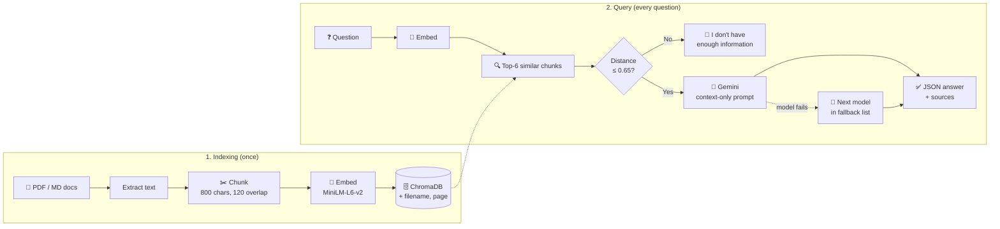

<div align="center">

# 📚 RAG Pipeline Prototype

**Ask questions about internal company documents and get answers that are grounded, cited, and honest about what they don't know.**


</div>

---

## ✨ What it does

This is an end-to-end **Retrieval-Augmented Generation (RAG)** pipeline. No model is trained or fine-tuned. Documents are indexed once, and at question time the most relevant pieces are retrieved and handed to the LLM, which must answer **only** from them.

| Capability | How it works |
|---|---|
| 📄 **Ingests documents** | PDFs (page by page) and Markdown/text files |
| ✂️ **Smart chunking** | Recursive character splitting, 800 chars with 120 overlap |
| 🏷️ **Source metadata** | Every chunk keeps `filename` and `page / section` |
| 🧠 **Local embeddings** | `all-MiniLM-L6-v2` via sentence-transformers (free, runs offline) |
| 🗄️ **Vector search** | ChromaDB with cosine similarity, persisted on disk |
| 🔗 **Cited answers** | Every answer lists `filename (location)`, including the PDF page number |
| 🛑 **No hallucination** | Out-of-scope questions return *"I don't have enough information."* |
| 🔁 **Resilient** | Retries with backoff, request timeouts, and automatic fallback across several Gemini models |

---

## 🏗️ Architecture



<details>
<summary><b>🔎 Why two layers of protection against hallucination?</b></summary>

1. **Retrieval gate:** if no chunk is close enough to the question (cosine distance above `0.65`), the LLM is never called and the refusal is returned immediately. This also saves API quota.
2. **Prompt gate:** when chunks do pass, the system prompt forces the model to use only that context and to answer *"I don't have enough information."* if the answer is not in it.

Even a typo such as `eit` (instead of `exit`) is refused instead of answered with a guess.

</details>

<details>
<summary><b>🔁 How does the model fallback work?</b></summary>

`rag.py` keeps an ordered list of models. Each call is tried with retries and a 30 second timeout. If a model fails for any reason (quota exhausted, outage, timeout, model retired), the pipeline logs which one failed and moves on to the next. Quota errors (429) are never retried on the same model, because a retry cannot succeed and only wastes requests.

</details>

---

## 🎬 Example session

```text
Q: What is the price of the Pro plan?
A: The Pro plan costs Rs 499 per month.
Sources: ['product_faq.md (full document)']

Q: What does the add gate do during backpropagation?
A: During backpropagation, the add gate always takes the gradient on its output and
   distributes it equally to all of its inputs, regardless of their values during
   the forward pass. This happens because the local gradient for the addition
   operation is +1.0, so the gradients on all inputs exactly equal the gradients
   on the output.
Sources: ['Backpropagation.pdf (page 9)', 'Backpropagation.pdf (page 5)']

Q: Who won the 2022 World Cup?
A: I don't have enough information.
Sources: []
```

The first two answers come with a citation (the second one down to the PDF page). The last question is outside the documents, so the pipeline refuses instead of guessing.

---

## 🚀 Quick start

```bash
# 1. Clone
git clone https://github.com/mehakrana16/rag-pipeline-task.git
cd rag-pipeline-task

# 2. Environment
python -m venv venv
venv\Scripts\activate          # Windows
# source venv/bin/activate     # macOS / Linux
pip install -r requirements.txt

# 3. API key (free at https://aistudio.google.com)
echo GEMINI_API_KEY=your_key_here > .env

# 4. Add your documents to docs/ (PDF, .md, .txt), then build the index and chat
python rag.py --rebuild
```

After the first build, just run `python rag.py` to reuse the existing index. Run with `--rebuild` whenever the files in `docs/` change, since the index does not pick up new or renamed files on its own.

<details>
<summary><b>⚙️ Configuration</b></summary>

| Setting | Default | Where | What it does |
|---|---|---|---|
| `chunk_size` | `800` | `build_index()` | Max characters per chunk |
| `overlap` | `120` | `build_index()` | Characters shared between neighbouring chunks |
| `k` | `6` | `ask()` | Number of chunks retrieved (raised from 4, see the retrieval miss below) |
| `max_dist` | `0.65` | `ask()` | Relevance cutoff. Raise it if valid questions get refused, lower it if out-of-scope questions get answered |
| `MODELS` | `gemini-3.5-flash-lite`, `gemini-3.1-flash-lite`, `gemini-3.7-flash`, `gemini-3.8-flash` | top of `rag.py` | Models tried in order. If one fails (quota, outage), the next one is used |
| timeout | `30 s` | `_call()` | Per-request limit so a stuck call fails fast and is retried |

</details>

---

## 🧪 Test results

Run the automated suite with `python test_rag.py`. Results are saved to `test_results.csv`, and answers are cached in `test_cache.json` so already-passed questions are not sent to the API again. To see which chunks a question retrieves and how close they are, run `python debug_retrieval.py "your question"`.

| # | Question | Expected | Answer | Source | Result |
|---|---|---|---|---|---|
| 1 | What is the price of the Pro plan? | Rs 499 | The Pro plan costs Rs 499 per month. | `product_faq.md` | ✅ |
| 2 | How often do I need to change my password? | 90 days | Passwords must be changed every 90 days. | `it_security.md` | ✅ |
| 3 | How long is the probation period? | 3 months | Probation period is 3 months. | `onboarding.md` | ✅ |
| 4 | How many casual leaves do I get? | 12 per year | Employees get 12 casual leaves per year. | `leave_policy.md` | ✅ |
| 5 | Can I work from home? | 2 days/week with approval | Employees can work from home up to 2 days per week with manager approval. | `work_hours.md` | ✅ |
| 6 | What is the meal limit during travel? | Rs 800/day | Meal expenses are reimbursed during official travel up to Rs 800 per day. | `expenses.md` | ✅ |
| 7 | What does the add gate do during backpropagation? | Distributes gradient equally | The add gate distributes the gradient equally to all of its inputs, regardless of their forward-pass values. | `Backpropagation.pdf (page 9)` | ✅ |
| 8 | What does the max gate do in the backward pass? | Routes gradient to highest input | The max gate routes the gradient unchanged to exactly one input, the one with the highest value. | `Backpropagation.pdf (page 9)` | ✅ |
| 9 | In the example f = (x+y)z with x=-2, y=5, z=-4, what is f? | -12 | f becomes -12 | `Backpropagation.pdf (page 3)` | ✅ |
| 10 | Why do we use += instead of = in backprop? | Gradients must accumulate at forks | Because the variable branches out to different parts of the circuit, gradients must be accumulated to avoid overwriting them. | `Backpropagation.pdf (page 8)` | ✅ |
| 11 | How is dW computed for matrix multiplication? | dD.dot(X.T) | dW is computed as dD.dot(X.T). | `Backpropagation.pdf (page 10)` | ✅ |
| 12 | Who is the CEO of Google? | Refusal | I don't have enough information. | none | ✅ |
| 13 | Who won the 2022 World Cup? | Refusal | I don't have enough information. | none | ✅ |

**Corpus used for testing:** 6 short Markdown documents (HR leave, work hours, expenses, product FAQ, IT security, onboarding) plus an 11-page machine learning PDF, which together produce 44 chunks. The PDF checks that page-level citations work on real multi-page documents.

---

## 🛠️ Problems hit while building (and how they were fixed)

<details>
<summary><b>Retrieval miss: relevant chunk ranked too low</b></summary>

The question "Why do we use += instead of = in backprop?" was refused even though the answer is on page 8 of the PDF. Debugging the retrieval (`debug_retrieval.py`) showed that the right chunk was ranked 6th (distance 0.54), while the pipeline only passed the top 4 chunks to the LLM, so the model correctly said it had no answer. Symbols like `+=` carry little meaning for the embedding model, which weakens the ranking: the same question in plain words ("Why do gradients add up at forks?") ranked that chunk 1st (distance 0.34). Raising `k` from 4 to 6 fixed it, at the cost of a slightly longer prompt. A reranker or hybrid keyword search would be the next improvement.

</details>

<details>
<summary><b>404 NOT_FOUND: model no longer available</b></summary>

`gemini-2.5-flash` is closed to new users. Fixed by switching to a newer model. Lesson: keep model names in one list at the top of the file so changing them is a one-line edit.

</details>

<details>
<summary><b>503 UNAVAILABLE: high demand</b></summary>

A temporary server-side spike crashed the first version, which had no retry. Fixed with `tenacity` exponential backoff.

</details>

<details>
<summary><b>Requests hanging for a minute or more</b></summary>

Some calls never returned. Fixed with a 30 second request timeout so a stuck call fails fast and is retried.

</details>

<details>
<summary><b>429 RESOURCE_EXHAUSTED: free-tier daily quota</b></summary>

The free tier allows only a small number of requests per day for each model, and blind retries were burning them. Fixed in four ways: quota errors are no longer retried, the retrieval gate skips the LLM call for out-of-scope questions, the test script caches answers that already passed, and the pipeline falls back to the next model in the list.

</details>

<details>
<summary><b>Slow answers (15 to 57 seconds each)</b></summary>

The slowness came from the API, not from retrieval, which takes well under a second. Moving the first choice to a lite model brought answers down to roughly 1 to 4 seconds.

</details>

<details>
<summary><b>New documents not showing up in answers</b></summary>

The index stores filenames inside Chroma, so adding or renaming a file in `docs/` has no effect until it is rebuilt. Fixed by adding the `--rebuild` flag and documenting it in the quick start.

</details>

---

## 📁 Project structure

```text
.
├── docs/                   # Source documents (PDF, .md, .txt)
├── rag.py                  # Ingestion, chunking, indexing, retrieval, generation, CLI
├── test_rag.py             # Automated test suite (writes test_results.csv)
├── debug_retrieval.py      # Shows retrieved chunks and distances for a question
├── test_api.py             # Quick check that the API key and model work
├── test_results.csv        # Latest test run
├── requirements.txt
├── .env                    # GEMINI_API_KEY (git-ignored)
├── test_cache.json         # Cached test answers (git-ignored)
└── chroma_db/              # Persisted vector index (git-ignored, auto-created)
```

---

## ✅ Task checklist

- [x] Ingest a set of company documents (PDF, Markdown) and extract clean text
- [x] Recursive chunking with overlap, preserving filename and page/section metadata
- [x] Embeddings indexed in a local vector database (ChromaDB)
- [x] Retrieval + generation chain with source citations and an explicit *"I don't have enough information"* refusal

**Verification from the brief:** the system retrieves relevant chunks, cites the exact source document (and page for PDFs), and refuses to hallucinate on out-of-scope questions. This is covered by the test table above (13/13 passing).

---

## ⚠️ Limitations and next steps

- Retrieval uses semantic search only. Adding hybrid keyword + semantic search or a reranker would help on exact-term and symbol-heavy queries.
- Quality is currently checked with a small hand-written test set. A larger golden dataset with Hit Rate / Recall@K and a faithfulness check would measure it more rigorously.
- Chunk size, `k` and `max_dist` were tuned by hand and can be tuned against such a dataset.
- Scanned PDFs (images without selectable text) are not supported, because text is extracted with `pypdf` and there is no OCR step.

---

<div align="center">

Built by **Mehak Rana** as part of the Ayava Creatives AI internship.

</div>